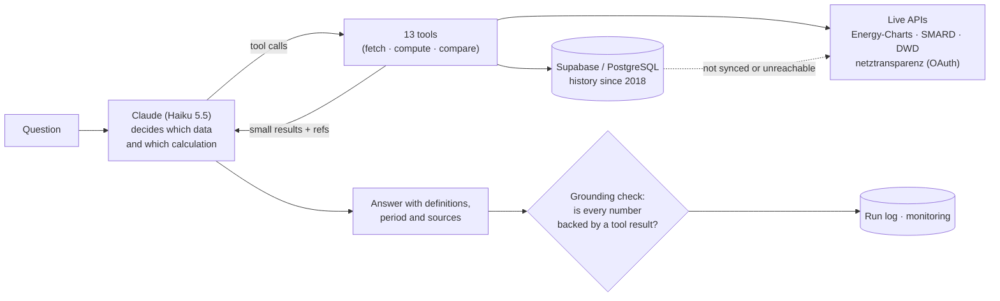

# GridAgent

An AI agent that answers research questions about Germany's electricity system:
generation, prices, cross-border trade, the weather behind them, and how they relate.
Every number comes from public data and deterministic code, never from the model's
memory or mental arithmetic, and that is checked automatically on every answer.

> **Q:** In October 2026, how did the day-ahead price in hours with little wind compare with windy hours?
>
> **A:** In October 2026 (1–31 Oct, German local time), the day-ahead price in hours with
> little wind (station wind below 3 m/s) averaged 214.84 EUR/MWh over 304 hours. In windy
> hours (above 5 m/s) it averaged 62.61 EUR/MWh over 144 hours, a difference of
> 152.23 EUR/MWh (ratio 3.43). These are my thresholds, not official definitions. The
> results show an association only; demand, gas prices and imports also shape prices. Wind
> is a station indicator at about 10 m height, not turbine hub-height wind, and the
> calculation uses hourly means.
>
> *Source: Bundesnetzagentur | SMARD.de via Energy-Charts.info (day-ahead prices, CC BY 4.0);
> Deutscher Wetterdienst (DWD), 65 stations (wind speed)*

*(Unedited answer from a live evaluation run of agent 0.7.0 on Claude Haiku 5.5: it fetched
prices and weather, ran four conditional calculations and one comparison, all in code.)*

**At a glance:** 13 tools · 62-question eval set · **95–98%** live pass rate on the
latest versions · **100%** of out-of-scope questions declined correctly · about **$0.001
and 7 s per question** · 417 tests · CI with free replay of real model answers · Docker · PostgreSQL
(Supabase) with 1.5 million rows since 2018.

---

## Why

Germany publishes excellent electricity data (Energy-Charts, SMARD, DWD), but answering
a question like *"what did solar power earn in October, and how does that compare with
the official market value?"* still means downloading data, handling 15-minute values,
daylight-saving days and changing definitions, and calculating carefully. That takes an
analyst 30–60 minutes. GridAgent answers in seconds, states its definitions and sources,
and shows how it calculated. It is built for researchers, consultants and analysts.

The main risk with AI in this domain is a confident, wrong number. The design is about
preventing exactly that.

## What it can answer

| Area | Example question | Data |
|---|---|---|
| Generation and demand | "What share of electricity came from wind last week?" | Energy-Charts (public and total net generation) |
| Prices and market values | "What did solar earn in October, compared with the official value?" | SMARD via Energy-Charts; official values from netztransparenz |
| Cross-border trade | "How much did Germany import, physically vs commercially?" | Energy-Charts (physical flows and scheduled exchanges) |
| Neighbouring markets | "In how many hours was France cheaper, and what did Germany import then?" | Day-ahead prices of the 11 neighbouring zones (CC BY 4.0) |
| Regions | "How much solar did the TenneT control area produce?" | SMARD control-area data |
| Capacity | "What was the onshore wind capacity factor in October?" | Energy-Charts installed capacity |
| Weather and its effects | "How many hours had neither wind nor sun, and how much gas ran then?" | DWD station observations (65 stations) |
| Grid congestion | "How much renewable power was curtailed by redispatch, and in which hours?" | netztransparenz.de (TSOs' redispatch measures; own account, see licences) |
| Official statistics | "What was the official renewable share in 2025?" | UBA, BDEW / AGEB (curated, with status: final, preliminary, reported) |

It declines what it should not do: forecasts, investment or trading advice, other
countries' domestic systems, and anything off-topic. Follow-up questions ("And the week
before?", "How does that compare with solar?") build on the conversation.

## How it works



Design decisions, and why:

- **The model decides, code calculates.** Claude chooses the data and the operation;
  `compute_stats`, `compute_when` and `compare_values` do every sum, share, price
  weighting, conditional average and difference. The model is told not to calculate,
  and `compare_values` only accepts numbers that earlier tool results produced.
- **Data stays on the server.** A month of 15-minute data is thousands of values. Tools
  store it behind a short `ref` (e.g. `gen_1`) and return only a summary, so prompts stay
  small (cheap, cacheable) and the model cannot mis-copy raw numbers.
- **Every answer is checked.** After each run, every number in the answer must match a
  tool result (allowing normal rounding and ×1000 unit changes). Unbacked numbers are
  written to the run log and counted in monitoring (`garden runs`), in production and in
  evaluations alike (`src/gridagent/tools/grounding.py`).
- **Definitions are explicit.** Public vs total net generation, physical vs commercial
  flows, AC vs DC solar capacity, quarter-hour vs hourly counts, preliminary vs final
  official figures: the agent states which one it used, because researchers compare.
- **Honest about weather.** Station wind is measured ~10 m above ground and averaged over
  65 stations: the agent calls it an indicator, states its thresholds, and reports an
  association, not a cause.
- **Versioned agents.** Each agent version is a folder (`agent.yaml` + system prompt) in a
  small registry, the "Agent Garden", and every version is evaluated on the same questions.

## How we know it works

**Three evaluation modes** on a fixed data world (recorded data, fixed "today"), so results
are reproducible:

| Mode | What it tests | Cost |
|---|---|---|
| Oracle | A scripted perfect agent: do tools, scoring and eval set agree? | free |
| Live | The real model on all questions (hard cost limit, `--max-cost`) | ~$0.05 per run |
| Replay | Recorded real answers re-checked against today's code (runs in CI) | free |

Each answer is scored on explicit rules: the expected numbers (±1%), whether those numbers
appear in tool results, whether *every* number is backed, dates, tool use, refusals,
missing-data handling and source citation. Expected values are recomputed **independently**
from the raw data in the tests, so a bug in the tools cannot hide in the eval set.

**Live results on Claude Haiku 5.5** (same questions; later versions add questions for
their new features):

| Version | Change | Questions | Live pass rate | What the evaluation found |
|---|---|---|---|---|
| 0.4.0 | follow-up conversations | 47 | 93.6% | the model worked out differences in its head |
| 0.5.0 | `compare_values` + grounding check | 50 | 96.0% | follow-up differences still mental |
| 0.6.0 | DWD weather, `compute_when` | 55 | 94.5% (98.2% after test fixes) | the eval itself was too strict once |
| 0.7.0 | neighbouring markets, follow-up rule | 59 | 98.3% | one count used hourly averages instead of 15-minute prices |
| **0.8.0** | grid congestion (redispatch) | **62** | **95.0%** (60 run before the cost limit) | a flipped price-spread sign in a follow-up; tools now spell signs out, and the re-run got it right |

In 0.8.0 the expected numbers were within ±1% in every answer, though one wrong answer
matched only by coincidence ("92" hours vs 91.22 GWh) and was failed by the stricter
grounding checks, which is why there are several. Refusals and source citation were 100%.
Average cost was $0.0010 per question (prompt caching, Haiku; it grows with the number of
tool descriptions), median latency 7 s. After fixing the tools and two over-strict grader
rules, the recorded answers replay at 100%; CI re-checks them on every push.

Things the evaluations and checks caught along the way, each now covered by a test: mental
arithmetic in answers; a misrounded expected answer in the eval set itself; a 4×
undercount of negative-price hours for years with hourly prices; two daylight-saving bugs
(the repeated hour when clocks go back); data sources that would have returned German
prices for a French request; a price-spread sign read the wrong way round; and a tool schema the API rejects (the API refused before the
model ran, so it cost nothing; a schema test and a one-question smoke test now come first).

## Data sources and licences

| Source | Data | Licence |
|---|---|---|
| [Energy-Charts](https://energy-charts.info) (Fraunhofer ISE) | generation, load, flows, capacity | CC BY 4.0 |
| [SMARD](https://www.smard.de) (Bundesnetzagentur) | day-ahead prices (DE-LU and 11 neighbouring zones), control areas | CC BY 4.0 |
| [DWD open data](https://opendata.dwd.de) | 10-minute wind and solar radiation, 65 stations | CC BY 4.0 |
| [netztransparenz.de](https://www.netztransparenz.de) (the four TSOs) | redispatch and countertrading measures | © TSOs: not openly licensed (see below) |
| UBA, BDEW / AGEB, netztransparenz | official statistics (curated file with source, date and status) | cited |

Only openly licensed price zones are offered; Energy-Charts marks other zones as
internal-use only.

**Redispatch data and its licence.** netztransparenz.de content is copyright-protected;
reproducing it needs the TSOs' prior written consent. So GridAgent fetches it with the
user's own free API account (OAuth 2.0 client credentials, `NTP_CLIENT_ID` /
`NTP_CLIENT_SECRET`), uses it for the account holder's own analysis, returns only
aggregates, and never commits real measures: tests and evals use a clearly labelled
**synthetic** file in the documented format, and a test fails if anything else appears
there. Publishing real measures would need the TSOs' permission.

## Quick start

```bash
uv sync                                   # Python 3.12, pinned dependencies (uv.lock)
uv run pytest                             # tests, offline
uv run garden eval energy_qa --oracle     # evaluation, free and offline

cp .env.example .env                      # add ANTHROPIC_API_KEY
set -a && source .env && set +a
uv run garden run energy_qa "What was the average day-ahead price yesterday?"
uv run garden chat energy_qa              # conversation with follow-up questions
```

**Website** for researchers and analysts (chat, charts with CSV download, plain-language
"How this was calculated", sources; no model or agent jargon):

```bash
uv sync --extra web --extra db
uv run --extra web garden ui              # http://localhost:8000 (listens on 127.0.0.1 only)
docker compose up --build                 # the same in Docker
```

The website has a spending limit (`GARDEN_UI_BUDGET_USD`, default $1.00) and runs on live
data, or on recorded data with `GARDEN_WEB_FIXTURES=1`.

## Command line

```bash
# Agent Garden
uv run garden list | validate | tools     # registry, config checks, available tools
uv run garden new my_agent                # scaffold a new agent from the template
uv run garden runs                        # monitoring: ok/error rate, latency, cost, unbacked numbers

# Evaluations
uv run garden eval energy_qa@0.7.0                                # replay if recorded, else oracle
uv run garden eval energy_qa --live --record --max-cost 0.10      # real model, hard limit
uv run garden eval energy_qa --live --case price_week_vs_october  # selected questions only
uv run garden compare energy_qa@0.6.0 energy_qa@0.7.0             # version vs version

# Database (optional; Supabase or any PostgreSQL)
uv run garden db init | create-reader | status
uv run garden db sync --since 2018-01-01 --regional-since 2026-01-01
```

## Database

History is served from PostgreSQL (Supabase, Frankfurt) when synced: faster, no rate
limits, any period length. Anything not synced yet, such as today, falls back to the live
APIs, and so does every request if the database is unreachable.

- One table per data type, 15-minute rows, values stored as fixed-point integers
  (value × 1000): exact for the 3 decimals the APIs deliver, as small as a 4-byte float.
- `energy.sync_log` records which days were loaded; a period is served from the database
  only if fully covered. Reads are packed per day (half the download) and cached on disk.
- The app reads with a read-only role; the owner credentials are used only for syncing.
- 2018 to today for power and prices, 2020 to today for weather: about 200 MB.

## Project layout

```
agents/energy_qa/        agent versions (agent.yaml + system_prompt.md), evals.yaml, recordings
src/gridagent/agent/     tool-use loop, conversations, run logs
src/gridagent/tools/     tool definitions, ToolBox, statistics, conditional stats, grounding check
src/gridagent/data/      API clients (Energy-Charts, SMARD, DWD), caching, recorded-data source
src/gridagent/db/        PostgreSQL schema, sync, database and hybrid data sources
src/gridagent/evals/     eval set, oracle/replay/live runner, scoring, reports
src/gridagent/web/       FastAPI backend and the static website
tests/                   417 tests; independent reference calculations; recorded API data
```

## Limits and responsible use

- **Germany only**, past data only (and tomorrow's prices once published). No forecasts,
  no investment or trading advice.
- **Preliminary data:** recent values are revised by the publishers; official figures are
  labelled final, preliminary, estimated or reported.
- **Weather is an indicator:** a plain mean over 65 stations (16 in Bavaria) at ~10 m
  height. Weather-related results are associations, with thresholds the agent states.
- **The grounding check is a heuristic:** it catches numbers no tool produced, but not
  arithmetic in words ("about a third"). Live results above are for one model on one
  question set; a new model or prompt needs a new live run.
- **Cost control:** hard limits on live evaluations and on the website; the API key is
  never stored in the image or the repository.

## Next steps

- Weather per control area, and climate context against the 1991–2020 normal.
- A nightly sync job (GitHub Actions) to keep the database current.

---

Data: Energy-Charts.info (Fraunhofer ISE), Bundesnetzagentur | SMARD.de and Deutscher
Wetterdienst, all CC BY 4.0. Built with the Claude API (Anthropic).
