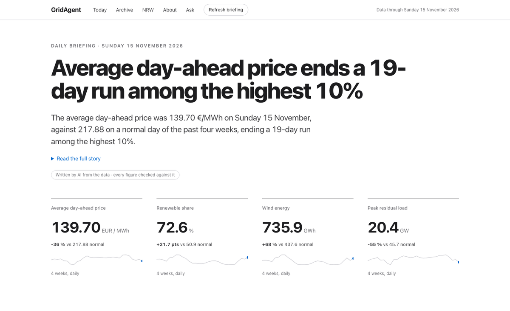
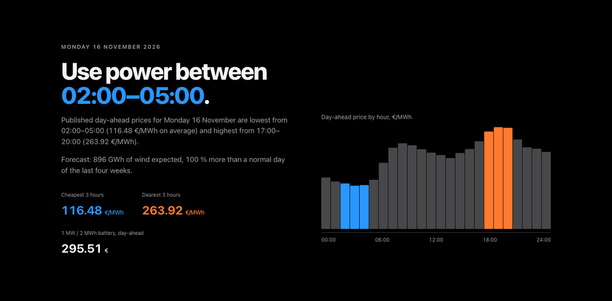
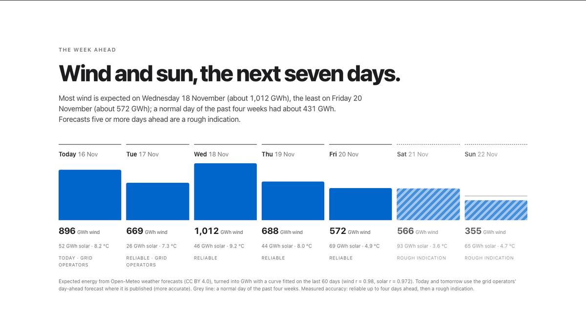
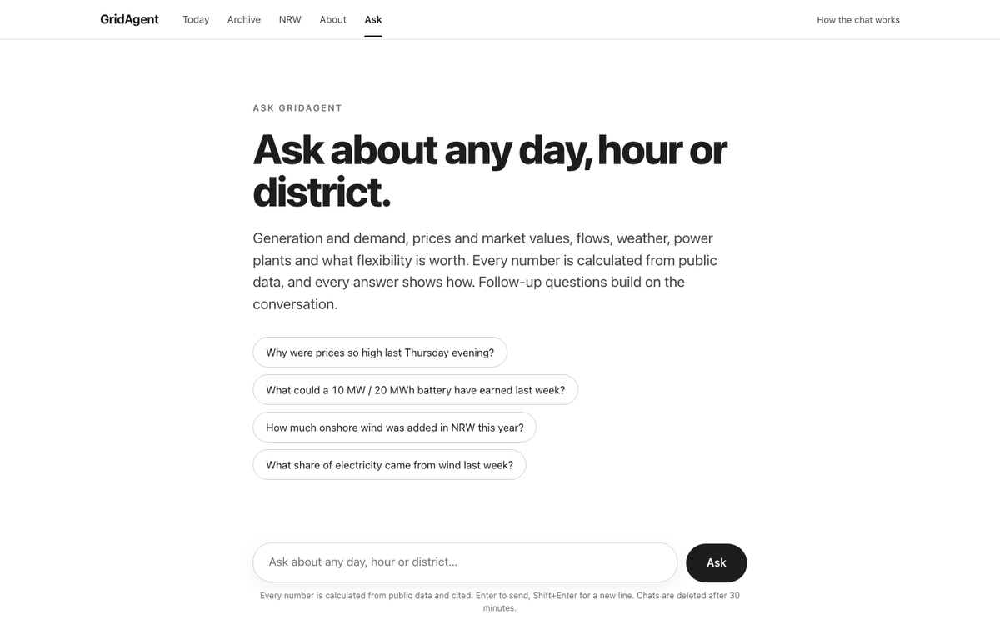
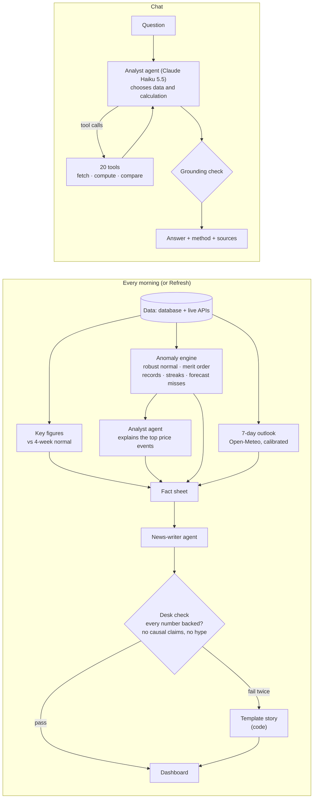

# GridAgent

A personal market monitor for Germany's electricity system, built on evaluated AI agents.
Every morning it reviews the previous day, finds what was unusual, explains it, looks a
week ahead, and lets you ask follow-up questions in a chat. Every number comes from public
data and deterministic code, never from the model's memory or mental arithmetic, and that
is checked automatically on every answer and every story.



**At a glance:** 2 agents (analyst and news writer) · 20 tools · 73-question eval set ·
**97.3%** live pass rate on the latest version (93.6–98.3% on every version since 0.4.0) ·
**100%** of out-of-scope questions declined · about **$0.001 and 9 s per question**, about
**$0.005 per daily briefing** · news writer: **94.1%** on 17 graded stories · 560 tests · CI that replays real model answers for free ·
Docker · PostgreSQL (Supabase) with history since 2018 · runs on your own machine.

---

## Why

Germany publishes excellent electricity data (Energy-Charts, SMARD, DWD, the plant register),
but turning it into "what happened yesterday, was it unusual, and why?" still means
downloading data, handling 15-minute values, daylight-saving days and changing definitions,
and calculating carefully: 30–60 minutes for an analyst. GridAgent does it every morning
and states its definitions and sources. The main risk with AI here is a confident, wrong
number; the design is about preventing exactly that.

## What you get

**A dashboard** at `http://localhost:8000`, rebuilt every morning:

| Section | What it shows |
|---|---|
| Story | Yesterday's lead story, written by the news-writer agent from calculated figures and checked number by number (labelled as AI-written; one click to the full text) |
| Key figures | Price, renewable share, wind, peak residual load, each against its four-week normal with a trend line |
| Today | Hourly day-ahead prices, the cheapest and dearest three hours, what a 1 MW / 2 MWh battery could earn |
| The week ahead | Expected wind and solar energy and temperature for seven days, each labelled *reliable* or *rough indication* from measured forecast accuracy |
| The last four weeks | Price and wind, day by day |
| What stood out | Price spikes and dips (explained by residual load, or not), records, streaks, unusual changes, forecast misses |
| NRW | New onshore wind per year, installed wind, solar, batteries and lignite, the districts building most |




**A chat** in the same design (`/ask`), for any question the dashboard raises:



| Area | Example question |
|---|---|
| Generation, demand, prices | "What share of electricity came from wind last week?" · "What did solar earn in October, compared with the official value?" |
| Why | "Why were prices so high on Thursday evening?" (merit-order estimate against comparable days) |
| Forecasts | "How windy will it be on Thursday?" · "How good was yesterday's wind forecast?" |
| What stood out | "What was unusual on 29 October?" (the same analysis as the dashboard) |
| Neighbours and flows | "In how many hours was France cheaper, and what did Germany import then?" |
| Weather | "How many hours had neither wind nor sun, and how much gas ran then?" |
| Flexibility | "What could a 10 MW / 20 MWh battery have earned last week?" |
| Power plants | "How much onshore wind was added in NRW districts since 2023?" |
| Official figures | "What was the official renewable share in 2025?" |

It reports published forecasts with their reliability but makes no predictions of its own,
gives no investment or trading advice, and declines anything off-topic. Follow-up questions
build on the conversation.

## How it works



Design decisions, and why:

- **The model decides, code calculates.** The agents choose data and operations; tools do
  every sum, share, weighting, comparison and optimisation. Tools return the derived numbers
  a reader wants (shares, spreads, differences), because live runs showed that models
  otherwise work them out in their heads.
- **Every number is checked.** After each answer and each story, every number must match a
  tool result or the fact sheet (normal rounding and ×1000 unit changes allowed). Answers
  log unbacked numbers; stories that fail are rewritten once, then replaced by a plain
  template version. A wrong story is never published.
- **News judgment in code, writing by the model.** The anomaly engine ranks candidate stories
  by surprise, size, duration and context. Price spikes are tested against a curved merit
  order fitted on four weeks: a spike the residual load predicts is *explained*; one it does
  not is the real news.
- **Forecasts with measured reliability.** The weather outlook's accuracy was measured for
  each lead time before it was shown (see below), and every day carries that label.
- **Data stays on the server.** Tools keep large series behind short refs (`gen_1`) and send
  the model only summaries: cheap, cacheable, and nothing to mis-copy.
- **Versioned agents.** Each version is a folder (`agent.yaml` + system prompt) in a small
  registry, the "Agent Garden", evaluated on the same questions.

## How we know it works

**Three evaluation modes** on a fixed data world (recorded data, fixed "today"):

| Mode | What it tests | Cost |
|---|---|---|
| Oracle | A scripted perfect agent: do tools, scoring and eval set agree? | free |
| Live | The real model on all questions (hard cost limit, `--max-cost`) | ~$0.08 per run |
| Replay | Recorded real answers re-checked against today's code (runs in CI) | free |

Each answer is scored on explicit rules: expected numbers (±1%), whether *every* number is
backed, dates, tool use, refusals, missing-data handling and source citation. Expected
values are recomputed **independently** from the raw data in the tests.

**Live results on Claude Haiku 5.5** (later versions add questions for their new features):

| Version | Change | Questions | Live pass rate | What the evaluation found |
|---|---|---|---|---|
| 0.4.0 | follow-up conversations | 47 | 93.6% | the model worked out differences in its head |
| 0.5.0 | `compare_values` + grounding check | 50 | 96.0% | follow-up differences still mental |
| 0.6.0 | DWD weather, `compute_when` | 55 | 94.5% (98.2% after test fixes) | the eval itself was too strict once |
| 0.7.0 | neighbouring markets, follow-up rule | 59 | 98.3% | one count used hourly averages instead of 15-minute prices |
| 0.8.0 | grid congestion (redispatch) | 62 | 95.0% | a flipped price-spread sign in a follow-up; tools now spell signs out |
| 0.10.0 | battery and flexible load, plant register | 68 | 95.6% | two shares worked out mentally; the tools now return shares |
| **0.12.0** | price-event investigator, forecasts, 7-day outlook, notable events | **73** | **97.3%** | a buy/sell spread worked out mentally (now returned by the tool); one investigation that never named its date |

0.12.0: answer accuracy 98.3%, refusals and source citation 100%, $0.0816 for 73 questions,
median 8.8 s. The recorded answers replay at 98.6% after the fix; CI re-checks them on
every push.

**The news writer has its own eval** (`garden eval-stories`): 17 briefings, 15 real days
chosen so every kind of lead story appears, quiet and busy days included, plus 2 edited to
tempt it into a broken rule (an analysis note that says "caused by"; a missing forecast).
The desk check only rejects broken rules; the eval asks what an editor asks next, graded in
code: does it lead with the lead story, read the merit-order result the right way round,
keep "since at least", give each number its comparison, avoid "will" and advice, look
ahead only when there is a forecast, and call a quiet day quiet?

| | Pass rate | Published by the model | First draft accepted | Cost |
|---|---|---|---|---|
| Template (code only, the baseline) | 100% | – | – | free |
| news_writer 0.3.0 (Haiku 5.5) | 94.1% (16/17) | 100% | 88% | $0.042 for 17 |
| **news_writer 0.4.0** | **94.1%** (16/17) | 100% | 82% | $0.046 for 17 |

The model has to match the template's correctness while writing better. 0.3.0's miss was
real: a day without stories framed as news ("Average price falls 8.8% below normal")
instead of called quiet. 0.4.0 adds one rule for it, and the same day now reads "Prices
run below normal on a quiet Saturday". It missed a different case instead: on one day it
led with the daily average rather than the evening spike the analysis ranked first, a case
0.3.0 got right. With 17 stories and one run each, the two versions score the same; the
fix is shown, an overall improvement is not. Reading the runs also showed four checks that
were too narrow ("a third day", "7.9 % below its forecast", "from 350.26 the day before",
a plan day named only by weekday); each was widened with a test, and both versions were
re-scored with the same checks. CI replays the recorded stories on every push. Its earlier live
stories found a token limit that cut a draft after the headline, paragraphs that turned
into lists of numbers, "sets a record" for "highest since at least", and mentions of its
own inputs; each is now a rule in the desk check.

**How far ahead is the weather forecast useful?** Measured, not assumed (`garden
forecast-skill`, Sep–Nov 2026, daily forecast against actual daily output):

| Days ahead | 1 | 2 | 3 | 4 | 5 | 6 | 7 |
|---|---|---|---|---|---|---|---|
| Wind (r) | 0.97 | 0.96 | 0.94 | 0.92 | 0.79 | 0.73 | 0.66 |
| Solar (r) | 0.97 | 0.96 | 0.94 | 0.93 | 0.87 | 0.81 | 0.85 |

For tomorrow, the grid operators' own forecast is better still (r 0.993) and is used instead.

Things the evaluations and checks caught along the way, each now covered by a test: mental
arithmetic in answers; a misrounded expected value in the eval set itself; a 4× undercount
of negative-price hours in years with hourly prices; two daylight-saving bugs; data sources
that would have returned German prices for a French request; a price-spread sign read the
wrong way round; tool schemas the API rejects (an unsupported keyword, then the limits on
nullable parameters and on the combined grammar of strict tools); a failed live question
saved as an empty recording; large power plants published without their municipality;
late registrations in the plant register; an API forecast type that returns no data; a
generic turbine power curve that made a wind index *worse*; and a `.gitignore` rule that
silently left a whole code package out of the repository (CI caught it).

## Data sources and licences

| Source | Data | Licence |
|---|---|---|
| [Energy-Charts](https://energy-charts.info) (Fraunhofer ISE) | generation, load, flows, capacity, grid operators' day-ahead forecasts | CC BY 4.0 |
| [SMARD](https://www.smard.de) (Bundesnetzagentur) | day-ahead prices (DE-LU and 11 neighbouring zones), control areas | CC BY 4.0 |
| [DWD open data](https://opendata.dwd.de) | 10-minute wind and solar radiation, 65 stations | CC BY 4.0 |
| [Open-Meteo](https://open-meteo.com) | weather forecasts up to 7 days, and as issued 1–7 days earlier | CC BY 4.0 (free tier, non-commercial) |
| [Marktstammdatenregister](https://www.marktstammdatenregister.de) (Bundesnetzagentur) | every power plant and storage unit, aggregated by municipality and year | dl-de/by-2-0 |
| [netztransparenz.de](https://www.netztransparenz.de) (the four TSOs) | redispatch and countertrading measures | © TSOs: not openly licensed (see below) |
| UBA, BDEW / AGEB, netztransparenz | official statistics (curated file with source, date and status) | cited |

**Redispatch data.** netztransparenz.de content is copyright-protected; reproducing it needs
the TSOs' written consent. GridAgent fetches it with the user's own free API account, uses
it for the account holder's own analysis, never shows it on the dashboard, and never commits
real measures: tests use a clearly labelled **synthetic** file, and a test fails otherwise.

**Why it is not a public website.** Everything is built for publishing (a static site and a
GitHub Pages workflow, AI text labelled, no cookies or external requests), but a regularly
updated, news-like page in Germany needs a legal notice (Impressum). GridAgent therefore runs
locally; the workflow can only be started by hand and refuses to publish without one.

## Quick start

```bash
cp .env.example .env              # ANTHROPIC_API_KEY; optional DATABASE_URL_READER
docker compose up -d --build      # the app at http://localhost:8000, restarts by itself
```

The app builds yesterday's briefing on its own (checking every 30 minutes) and has a
Refresh button. Without an API key the dashboard still works (its story is then the
template version written by code), but the chat is unavailable. Spending is capped
(`GARDEN_UI_BUDGET_USD`, default $1.00).

Without Docker:

```bash
uv sync --extra web --extra db                     # Python 3.12, pinned (uv.lock)
set -a && source .env && set +a
uv run --extra web garden ui                       # the same app at http://localhost:8000
uv run --extra db garden today                     # or: build the briefing and open the page
uv run pytest                                      # tests, offline
uv run ruff check . && uv run mypy                 # lint and type check (both run in CI)
```

## Command line

```bash
# Daily monitor
uv run garden brief [--day 2026-11-15] [--no-explain]       # briefing (story by the model unless --no-explain)
uv run garden today                                          # briefing + local page, opened in the browser
uv run garden anomalies --start 2026-10-18 --end 2026-11-15  # backtest the anomaly engine (free)
uv run garden forecast-skill --start 2026-09-01 --end 2026-11-14

# Agents and evaluations
uv run garden list | validate | tools
uv run garden run energy_qa "What was the average day-ahead price yesterday?"
uv run garden chat energy_qa
uv run garden eval energy_qa                                      # replay if recorded, else oracle
uv run garden eval energy_qa --live --record --max-cost 0.15      # real model, hard limit
uv run garden compare energy_qa@0.10.0 energy_qa@0.12.0
uv run garden eval-stories [--template | --live --record]         # news writer (replay: free)
uv run garden runs                                                # monitoring of logged runs

# Plant register (Marktstammdatenregister)
uv run garden mastr sync --upload       # ~1.7 GB of the 3.3 GB export via HTTP range requests, stored in the database
uv run garden mastr export nrw_wind.csv --state Nordrhein-Westfalen --technology wind

# Database (optional; Supabase or any PostgreSQL)
uv run garden db init | create-reader | status
uv run garden db sync --since 2018-01-01 --regional-since 2026-01-01
```

## Database

History is served from PostgreSQL (Supabase, Frankfurt) when synced; anything not synced
yet, such as today, falls back to the live APIs, and so does every request if the database
is unreachable. One table per data type, 15-minute rows as fixed-point integers (exact for
the 3 decimals the APIs deliver); `energy.sync_log` records which days were loaded; the app
reads with a read-only role. The plant register is stored as one compressed aggregate per
export (3.7 MB, the newest four kept, which shows how late registrations revise figures).

## Plant register

The Marktstammdatenregister lists about 7 million generating and storage units. `garden
mastr sync` never downloads the whole 3.3 GB export: it reads the ZIP's table of contents
over HTTP range requests and streams only the unit files, keeping an aggregate (municipality
× technology × year: added, decommissioned, planned, community-owned wind). National totals
agree with Energy-Charts within 0.1–0.7% for wind, coal and biomass. Large plants are
published with their district but not their municipality, and late registrations make the
latest months grow afterwards: both are stated in every answer. `garden mastr export`
writes a balanced municipality × year panel for research.

## Project layout

```
agents/energy_qa/        analyst agent: versions (agent.yaml + system prompt), evals.yaml, recordings
agents/news_writer/      news-writer agent: versions, the newsroom style guide, story evals
src/gridagent/agent/     tool-use loop, conversations, run logs
src/gridagent/tools/     tool definitions, ToolBox, statistics, investigator, battery, register, grounding
src/gridagent/monitor/   daily briefing: figures, anomaly engine, forecasts, outlook, explanations, writer, captions
src/gridagent/data/      API clients (Energy-Charts, SMARD, DWD, Open-Meteo, netztransparenz, MaStR), caching
src/gridagent/db/        PostgreSQL schema, sync, database and hybrid data sources
src/gridagent/evals/     eval set, oracle/replay/live runner, scoring, reports
src/gridagent/site/      static dashboard pages (inline SVG charts, no scripts)
src/gridagent/web/       FastAPI app: dashboard, chat, refresh, daily background briefing
tests/                   538 tests; independent reference calculations; recorded API data
```

## Limits and responsible use

- **Germany and its neighbours.** Past data, plus published day-ahead prices and published
  forecasts with their reliability; no predictions of its own, no investment or trading advice.
- **Preliminary data:** recent values are revised by the publishers; official figures are
  labelled final, preliminary, estimated or reported.
- **Associations, not causes.** Weather, residual load and anomaly results describe what
  coincided; the dashboard and the agents say so.
- **The checks are heuristics:** they catch numbers no tool produced, causal wording and
  hype, but not every weak argument. Live results are for one model on one question set; a
  new model or prompt needs a new live run.
- **Cost control:** hard limits on live evaluations, on the app and on the daily briefing;
  the API key is never stored in the image or the repository.

## Next steps

- A price forecast for tomorrow from the published forecasts, backtested against the
  auction results and simple baselines.
- Phone alerts (negative prices tomorrow, cheapest hours, spikes).
- Battery value on intraday prices (the day-ahead result is an upper bound only).

---

Data: Energy-Charts.info (Fraunhofer ISE), Bundesnetzagentur | SMARD.de, Deutscher
Wetterdienst and Open-Meteo, all CC BY 4.0; Marktstammdatenregister, © Bundesnetzagentur,
dl-de/by-2-0. Built with the Claude API (Anthropic).
